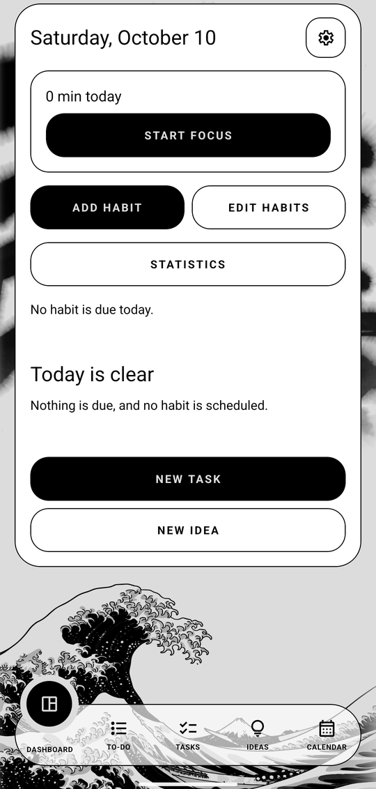
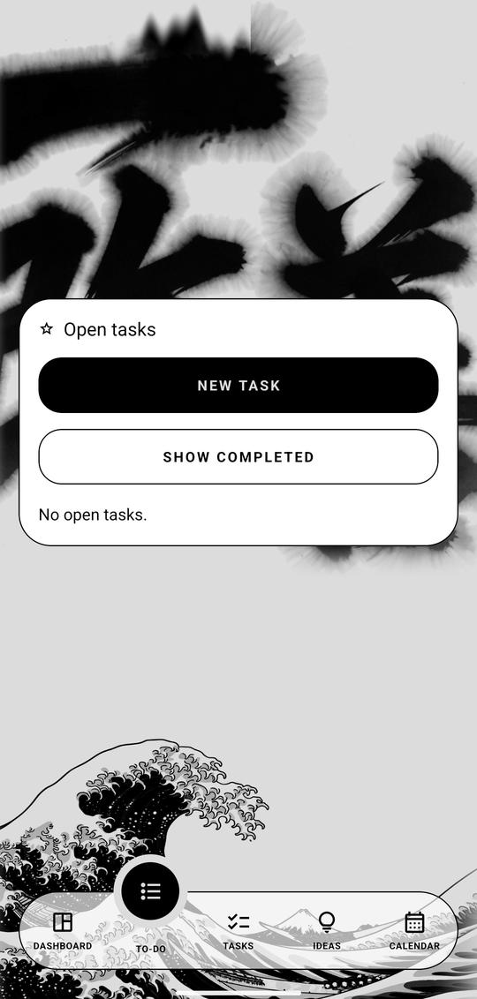
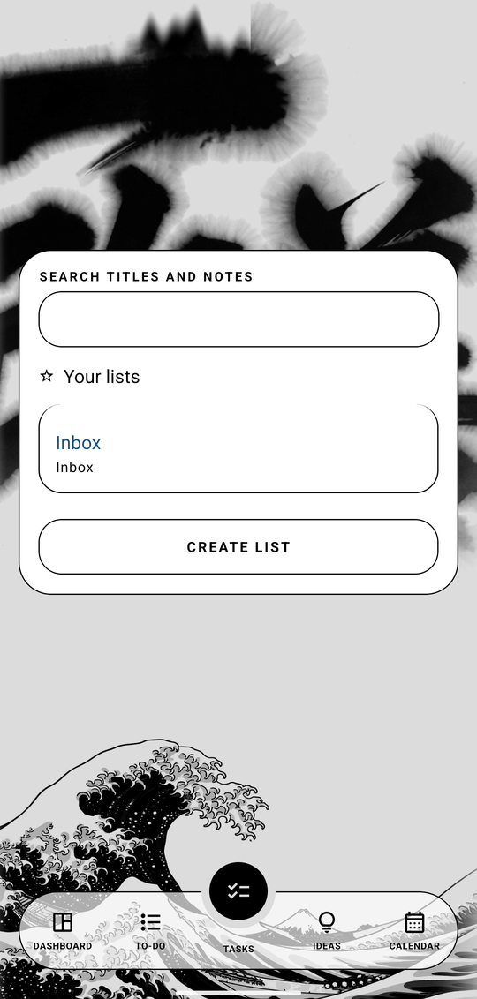
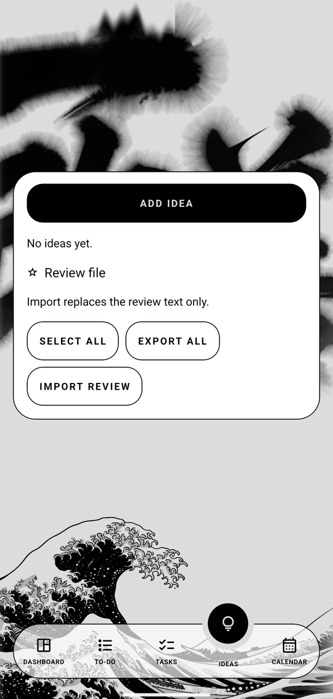
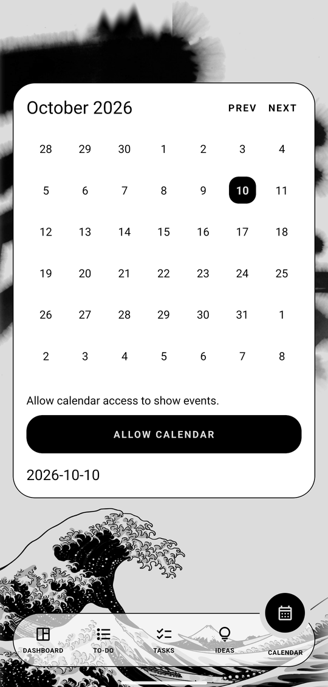

<p align="center">
  
</p>

<h1 align="center">Organice</h1>

<p align="center">
  A day planner that lives on your phone.
</p>

<p align="center">
  <a href="LICENSE"></a>
  
  
</p>

<p align="center">
  
  
  
</p>

<p align="center">
  
  
</p>

Organice keeps tasks, ideas, habits, a focus timer, and your calendar in one file on the device. There is no account and no server.

If a Google account is already on the phone, its events show up here. Organice reads the calendar the phone already has. It does not sign in to Google, and it does not keep a Google token.

## 📲 Install

You need Node.js with npm, a JDK (Java Development Kit) 17 or newer, and Android Studio with Android SDK Platform 36. Plug the phone in and turn on USB debugging. `adb devices` should list the phone with the word `device` beside it.

This repository uses npm. The lockfile is `package-lock.json`.

```bash
npm install
npm run android
```

`npm install` downloads the libraries pinned by the lockfile. `npm run android` compiles a development build and installs it on the attached phone. A development build is your own copy of Organice, with its native modules included. Open Organice from the phone after the command finishes.

Expo Go will not run this app. Expo Go is a sandbox, and it does not include the phone calendar module Organice uses. Use the two commands above.

On a Mac with Xcode installed:

```bash
npm run ios
```

## 🧪 Test

These two commands do not need a phone.

```bash
npm test
npm run typecheck
```

`npm test` runs the data rules. `npm run typecheck` checks the TypeScript types. It does not write output files.

## 📦 Compile

A release build packs the app into a file you can install without a development server.

Android:

```bash
npx expo run:android --variant release
```

The APK (Android Package, the file Android installs) is written under `android/app/build/outputs/apk/release/`. The `android` folder is generated when you compile. You do not create that folder by hand.

The current Android APK is also attached to [the GitHub release](https://github.com/CyBaiSecurity/Organice/releases/latest). That file is built for 64-bit ARM phones. Android calls that processor `arm64-v8a`. A 32-bit phone cannot install it.

If your own release build stops and the log says `Metaspace`, open the generated file `android/gradle.properties`. Metaspace is the memory Java uses to keep loaded classes. The generated cap is 256 MB, and the release check loads more classes than that. Change the `org.gradle.jvmargs` line so it includes `-XX:MaxMetaspaceSize=768m`, then run the same compile command again.

An iOS build needs a Mac and Xcode. `npm run ios` is the command on that Mac. This repository's release file is the Android APK.

## 🧭 Usage

1. Open **Dashboard**. That screen is today: habits that are due, overdue tasks, and what falls inside your working hours.
2. Tap **Start focus** when you want a timer. Tap **Add habit** when you want a new one.
3. Open **To-do** when you want every open task, not only today's. Tap **Done** on a row to finish it.
4. Open **Tasks** to make a list, search, or open a list. A list can be a plain list, a board, or a timeline. The switch is the menu at the top right of the list.
5. Open **Ideas** to park a thought. Add it, then compile the ones you want into a list.
6. Open **Calendar** for the month. Tap a day to see that day's tasks and events.
7. The gear on the dashboard opens **Settings**.

Pull down on the dashboard or the calendar to reload.

**Inbox** is the list Organice creates the first time you open it. You can put tasks in it. You cannot rename it or delete it.

## ✨ Functions

### 🏠 Dashboard

- Today's date, and the gear for Settings.
- **Start focus** or **Open focus** when a timer is already running.
- **Add habit**, **Edit habits**, and **Statistics**.
- Check a yes-or-no habit, or change today's count on a count habit, only on a day that habit is due.
- Overdue tasks sit above the day.
- Timed tasks and calendar events inside working hours, with all-day items above them.
- **Outside working hours** opens the rest.
- On an empty day: **New task** and **New idea**.

### ✅ To-do

- Every task, from every list.
- **New task**.
- **Show completed** and **Hide completed**.
- **Done** marks a task complete. A repeating task moves to its next time instead of closing forever.
- Tap a row to open the task. The title color follows its priority.

### 📋 Tasks and lists

- **Search titles and notes** filters tasks as you type.
- **Create list**, with a name and a color: Ink, Pine, Clay, Plum, Slate, or Amber.
- **Up** and **Down** change list order.
- Tap a list to open it.
- Inside a list, the top-right menu picks **List**, **Board**, or **Timeline**.
- **More** holds show completed, select, add section, and delete list. Delete asks first. Inbox has no delete.
- **Save name** renames a list that is not Inbox.
- **New task**. On a board, each column has its own **Add task**.
- Select tasks, then **Complete selected** or **Delete selected**.

**Board.** Columns are sections you name. Drag a card to another column or to a new place in the same column. **Left**, **Right**, **Rename**, and **Delete** sit on each section. Deleting a section keeps the tasks and moves them to **No section**.

**Timeline.** Seven days. **Earlier** and **Later** shift the window. A task with a start and a deadline is a bar. Drag the bar to move it. Drag the right edge to change the end. Tap an empty time to start a task there. Tasks with no start sit in the side column.

### ✏️ Task

- Title and notes. Save is at the top.
- List, section, priority (none, low, medium, high), start, and deadline.
- Start and deadline use an alarm-style clock: hour, minute, and AM/PM.
- All-day keeps the date and drops the clock. An all-day reminder is 9:00 on that day.
- Repeat: none, daily, weekly, monthly, or a number of days after you complete it. Weekly lets you pick the days.
- Reminder: none, at the deadline, 5 minutes, 15 minutes, 1 hour, or 1 day before.
- **Snooze reminder** for 10 minutes, 1 hour, or tomorrow morning. Snooze moves the reminder only. The deadline stays.
- **Also show on the phone calendar** writes the task onto the calendar you chose in Settings.
- Checklist lines: add, check, remove, and move up or down. Checking every line does not complete the task.
- **Complete**, **Reopen**, and **Delete task**. Delete asks first.

Low is green. Medium and high have their own colors. A finished task is struck through on the calendar.

### 💡 Ideas

- **Add idea**, then a title and notes.
- **Select all**, then tap rows to narrow the selection.
- **Compile into** a list. Each selected idea becomes one task. The idea stays. Compiling the same idea again asks first, because a task already exists.
- **Export all** or **Export selected** writes a JSON file you can hand to a desktop review.
- **Import review** updates the review text only. The title and the notes stay as you wrote them.
- **Delete idea** asks first. It does not delete the task you already compiled.

### 📅 Calendar

- Month grid. A day with a task or an overlapping event is marked. Today is highlighted.
- **Prev** and **Next** change the month.
- Tap a day for all-day items, then timed ones. A task opens in Organice. An event opens in the phone's calendar.
- The first time you open the tab, Organice asks for calendar permission.

### 🎯 Focus

- **Countdown** or **Count up**.
- Defaults are 25 minutes of focus, a 5 minute short break, and a 15 minute long break after every 4 focus sessions. Change those in Settings.
- White noise: Silence, Rain, Café, or Wind.
- Link the session to an open task, an active habit, or neither.
- **Start focus**, **Stop** on a count-up, and **Abandon**. Starting another session asks before it abandons the one that is running.
- A countdown rolls into the break on its own. The next focus waits until you tap Start.
- The dashboard shows today's finished focus time when nothing is running.

### 🔁 Habits

- **Create habit**: a name, yes-or-no or count, the weekdays it is due, and for a count habit a daily goal and a unit such as pages.
- The Check control shows up only on a due day.
- Open a habit for the month. Tap a past due day to check it. Long-press a count to lower it. Future days cannot be checked.
- Optional reminder at a 24-hour time, such as 07:30, on the chosen weekdays.
- **Archive habit** hides it from today and keeps the check-ins. **Restore habit** brings it back.
- **Delete** asks, then removes the habit and its check-ins.
- **Statistics** shows the last 8 weeks. Tap a habit for the week and weekday bars. **Export CSV** shares that record.

### ⚙️ Settings

- Appearance: System, Light, or Dark.
- Working hours, as 24-hour times. The dashboard's main list stays inside that window.
- Focus length, short break, long break, and how many focus sessions happen before a long break.
- The default list for a new task.
- The writable calendar on this phone. That is where "Also show on the phone calendar" writes.
- The default white noise and the default reminder for a new task.
- **Check notification permission**, and a button to open the phone settings if reminders are blocked.
- **Export database**. The file is a copy of your data, and it is not encrypted. Keep it private.

Your tasks, ideas, habits, and focus history are in `organice.db` on the phone. Installing a newer build over the existing app keeps that file when the package name and the signing certificate stay the same and the version code is higher. Uninstalling the app, or losing the phone without an export, loses that file.

## 📄 License

Organice is released under the [MIT license](LICENSE).

The original create-expo-app template is also MIT licensed, by 650 Industries, Inc.
